  

  Computer Engineer · MSc in Data Science, Sapienza University of Rome

  <a href="https://onurozansunger.com.tr">Portfolio ↗</a>
  &nbsp; · &nbsp;
  <a href="mailto:onurozansunger@gmail.com">Email ↗</a>

## Projects

<table>
<tr>
<td width="50%" valign="top">

### [Wind turbine maintenance ↗](https://github.com/SEO-Dynamics/Wind-Turbine-Predictive-Maintenance-Platform)

Developed the failure-prediction module in a team project: 48-hour forecasts, leakage-aware validation and model explanations, with FastAPI and Streamlit.

Synthetic SCADA data · Advisory prototype

</td>
<td width="50%" valign="top">

### [Battery digital twin ↗](https://github.com/onurozansunger/Battery-Digital-Twin-and-Predictive-Intelligence-Platform)

Remaining-life estimation and uncertainty-aware fleet monitoring on NASA battery-aging data. Includes model monitoring, registry, promotion gates, APIs and dashboards.

MLOps · Research prototype

</td>
</tr>
<tr>
<td width="50%" valign="top">

### [Sensor-attack detection ↗](https://github.com/onurozansunger/wdn-thesis)

Hybrid mixture of experts for sensor-attack detection in water-distribution networks. Modena and L-Town results, source code and reproducible evaluation.

Anomaly detection · MSc thesis

</td>
<td width="50%" valign="top">

### [Network medicine ↗](https://github.com/onurozansunger/BNM-anxiety-network-medicine)

Protein-interaction networks, DIAMOnD and heat diffusion for gene ranking, enrichment analysis and drug-repurposing candidate screening for anxiety disorders.

Computational biology · Academic group project

</td>
</tr>
</table>

[Facial emotion recognition](https://github.com/onurozansunger/facial-emotion-recognition): real-time CNNs, TFLite, OpenCV. 
[Reinforcement learning](https://github.com/onurozansunger/Cartpole-and-RL): DQN, A2C, DDPG, PPO.

## Tools

Python · Java · PostgreSQL · PyTorch · TensorFlow · scikit-learn · OpenCV 
FastAPI · Streamlit · Docker · Git · Linux

## Background

- MSc in Data Science, Sapienza University of Rome; BSc in Computer Engineering, OSTIM Technical University.
- Internships: KAREL Electronics (embedded R&D); Presidency of Revenue Administration (backend and ML-powered web development).
- Former President, IEEE OSTIMTECH Student Branch.

Turkish (native) · English (C1) · Italian (A2) · German (A1)
